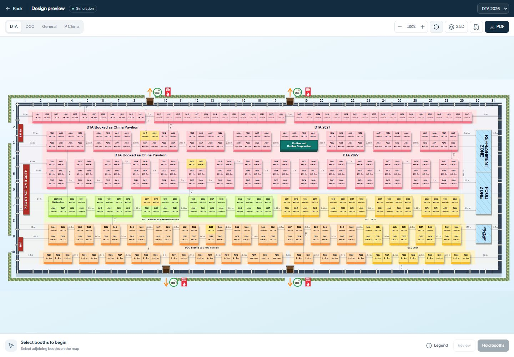

# Floorplan bar redesign

Updated 26 October 2026 following the marked header/footer screenshots.

Only the surrounding controls and presentation were redesigned. All 375 booths,
geometry, pavilion artwork, typography inside the SVG, colors, shadows, camera
behavior, selection/hold logic and export implementation remain unchanged.

## Interface

- Compact navy identity bar: Design preview, a small Simulation badge and edition
  chooser. The repeated hall title and persistent instruction/legend paragraphs
  have been removed from the bars.
- White control strip: grouped exhibition/pavilion navigation, icon-only alignment
  controls with accessible labels/tooltips, grouped zoom, fit, 2D/2.5D, fullscreen,
  SVG and PDF controls. The PDF action keeps its existing export behavior.
- Simplified footer: selection count, area and total; one line of booth context;
  a collapsible Legend; Review and Hold booths. Full selected codes and booking
  conditions remain available in Review. Hold expiry is available in booth context.
- Fullscreen contains the map and its bars only. The studio navigation becomes
  hidden and inert. The floating Back to dashboard button has been removed.
  A single Back button sits beside Design preview in the identity bar.
- Back and Escape restore the surrounding navigation and previous keyboard focus.
  The fullscreen keyboard focus loop includes the new Legend toggle.

## Verification

- Production build, TypeScript and all 24 geometry/camera/hold/palette tests pass.
  Lint has zero errors and the same eight inherited dependency-array warnings.
- Browser checks at 1440×1000 and 390×844: no horizontal overflow; fullscreen
  navigation hidden; Back beside Design preview; Back/ Escape exit and restored
  focus; pavilion navigation, zoom, projection switch, alignment, two-booth totals,
  Legend toggle and Review/Clear remain functional.
- Actual PDF download reopened with pypdf. Its 6600×2713 map image was compared
  against the preceding version: RGB pixels and alpha pixels are identical.
  The soft shadow and all map artwork are preserved exactly in that comparison.
- Geometry, artwork, export helpers, assets and map-drawing SVG markup were not
  modified. Existing registration forms and their PDF exporters were not modified.

[Inline view](floorplan-evidence/bars-inline.png) ·
[Mobile fullscreen](floorplan-evidence/bars-mobile.png) ·
[Selected booths and Review](floorplan-evidence/bars-selection.png)
