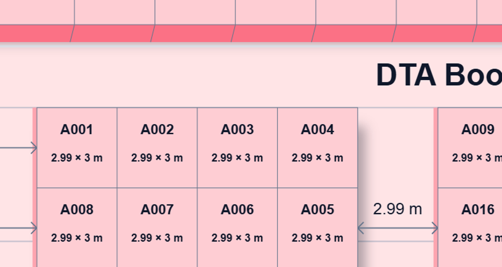

# Floorplan import and verification

This records the original import baseline. The surrounding bars were subsequently
redesigned at the user's request; see [the bar update and checks](floorplan-bars.md).

Verified on 26 October 2026 using the current working-tree implementation of
`C:\Users\Backtend\Music\ECO EXPO` at `/exhibitor/floor-plan`, run on port 3107.
The reference was captured before modifying Form Studio. The source viewer was
copied, including its CSS modules, SVG artwork, geometry, fonts and interactions.
The admin builder, dashboard seed data, authentication and backend were excluded.

## Integration

- `#floorplan` mounts a lazy-loaded, full-width viewer below Form Studio navigation.
  No registration sheet or editor is mounted beside it. Hash reload and browser
  back/forward work through the existing hash subscription.
- The standalone context supplies public preview edition metadata and a 24-hour
  hold policy. It imports no original account data or booking commands.
- Session holds use `ecoexpo-formstudio-map-preview-holds-*`; introduction counters
  use `ecoexpo-formstudio-map-expand-v1-*` and `ecoexpo-formstudio-map-align-v1-*`.
  They cannot collide with the source app or registration-form storage.
- Source expansion stages, activity/hover timers, introductory autoplay limits,
  keyboard handling, focus restoration, responsive rules and reduced-motion
  handling are retained. The host supplies the source's Instrument Sans, relative
  line-height and inherited font weight within this page only.
- The SVG export remains vector artwork with its original Gaussian filter.

## PDF shadow fix

The Floorplan **Print / PDF** button now directly downloads an A3 landscape PDF.
This is an intentional change requested during implementation. Browser printing
remains available through Ctrl/Cmd+P with isolated map print styles.

The PDF uses the browser's rendering of the original SVG at up to 6600 pixels on
its longest edge, including the original Gaussian shadow. The map in this PDF is
a high-resolution image, so its text is not independently selectable. The SVG
download remains available for vector artwork. No substitute shadow stroke was
added. Native browser printing receives a transparent, pre-rendered shadow layer
while retaining vector artwork and text above it.

The actual downloaded PDF was reopened with pypdf and rendered with Poppler.
It has one A3 landscape page, a complete hall, and a 6600-pixel image with alpha.
The saved close-up shows the blur fading beyond booth sides and bases.

## Checks completed

- Production build and TypeScript passed.
- `npm run lint` exits successfully: zero errors, eight inherited dependency-array
  warnings in the imported viewer. Its camera/event synchronization is retained;
  the original ref and effect patterns have narrowly documented lint exceptions.
- `npm run test:floorplan`: 17 geometry/camera/hold checks and seven palette checks.
  These cover all 375 footprints, structure grouping, stable IDs, example booked
  booths, alignment insets, portrait/landscape fitting, pending/confirmed colors,
  and removal of expired, blocked, unknown and duplicate hold IDs.
- A direct deep comparison against the source returned equal geometry, layout,
  structures and prices for all 375 stalls.
- Browser checks: DTA/DCC and pavilion navigation; zoom in/out; fit; drag-to-pan;
  2D/2.5D; expansion and Escape/back; activity-triggered automatic expansion;
  keyboard browsing and selection; all six alignment controls; review and clear;
  pending A017 and confirmed A045 refusal; simulated hold save and reload;
  SVG and actual PDF downloads; direct hash reload and history navigation.
- The implementation imports no backend modules and contains no fetch, API or
  booking request code. It cannot modify the original system.
- After visiting Floorplan, all four original page downloads still succeeded.
  DTA, DCC and DME remain one-page editable PDFs with 28, 24 and 28 field-tree
  entries respectively; Barter Agreement remains its one-page static export.
  DTA and Barter Agreement PDF renders were also visually inspected. Their form,
  editor and PDF implementation files were not changed.

## Visual comparison and limits

Reference and production screenshots were compared at 1440×1000 and 390×844.
The expanded desktop SVG viewport rectangles and camera viewBoxes were equal.
The measured desktop map crop had 99.92% identical pixels; remaining channel
differences were at most 5/255 in a few text antialiasing pixels. The whole desktop
screenshot was 99.56% identical, including differences caused by the source dev
badge and button hover state. This is visual evidence, not a promise of identical
pixels in every browser, PDF reader, printer, device or zoom level.

The review dialog, selected state, narrow wrapping and complete hall artwork were
also compared. Source automatic expansion transitions completed in the browser;
their millisecond timing and reduced-motion branches were preserved from source,
but not instrumented under every OS preference. Expiry was tested through the
sanitizer rather than waiting 24 hours. The downloaded PDF was visually verified;
an OS printer dialog was not used for acceptance.

| State | Reference | Form Studio |
| --- | --- | --- |
| Expanded desktop | [Screenshot](floorplan-evidence/reference-expanded.png) | [Screenshot](floorplan-evidence/target-expanded.png) |
| Narrow expanded | [Screenshot](floorplan-evidence/reference-narrow.png) | [Screenshot](floorplan-evidence/target-narrow.png) |
| Selected review | [Screenshot](floorplan-evidence/reference-review.png) | [Screenshot](floorplan-evidence/target-review.png) |

[Form Studio surrounding navigation](floorplan-evidence/target-inline.png)

Tracked source files were left unchanged. Running the reference generated an
untracked `.next-formstudio-reference` cache in the source folder. Automatic
approval review blocked its cleanup, so that temporary cache was left in place.
